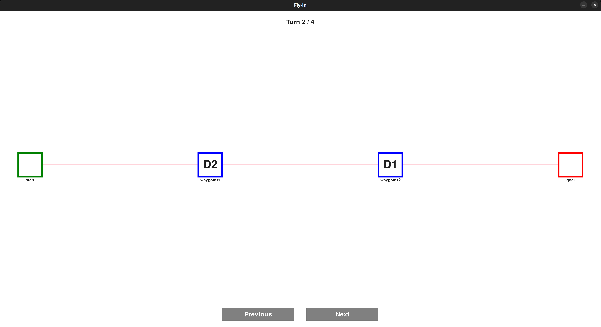

*This project has been created as part of the 42 curriculum by chilim*

# Description

Fly-in is a Python drone-routing simulator that moves multiple drones through
connected zones while aiming to minimize the number of turns. It respects zone
and connection capacities, avoids blocked zones, and accounts for restricted-zone
travel times. Results can be viewed as terminal output or replayed in an
interactive Pygame window.

# Instructions 

### Requirements

- Python 3.10 or later
- `make`
- A graphical desktop environment for visualization mode

### Install dependencies

From the project root, run:
```sh
make install
```

This creates a virtual environment at `.venv/` and installs the runtime
dependencies (`pydantic` and `pygame`) and development tools (`flake8`
and `mypy`). An internet connection is required to download these packages
during installation. Once installed, the program can run offline.

### Run in text mode

Run the default map in text mode:

```sh
make run
```

Run a specific map in text mode:

```sh
make run MAP=maps/hard/03_ultimate_challenge.txt
```

### Run in visualization mode

Open the default map in a Pygame window:

```sh
make visual
```

Open a specific map in a Pygame window:
```sh
make visual MAP=maps/medium/02_circular_loop.txt
```

**Note:** Use `make visual`, not `make run visual`. Passing both targets runs the simulation twice: first in text mode, then in visualization mode.

### Run via the Python entry point

```
.venv/bin/python main.py <map_file_path> [--visual]
```

- `<map_file_path>`: required path to a map file.
- `--visual`: optional flag that enables graphical visualization.
  Place it after the map path.

Paths are relative to the current working directory unless an absolute path
is supplied. Errors are printed to standard error, and the program exits
with a nonzero status when execution fails.

### Development commands

Run linter-standard check and type annotation check:
```sh
make lint
```

Run the same code-style checks with stricter type checking:
```sh
make lint-strict
```

Run the program using Python's debugger:
```sh
make debug MAP=maps/easy/01_linear_path.txt
```

Remove generated caches only:
```sh
make clean
```

Remove generated caches and the virtual environment:
```sh
make fclean
```

After `make fclean`, run `make install` before executing the program again.

# See It in Action

## Example input

```text
# Easy Level 1: Simple linear path
nb_drones: 2

start_hub: start 0 0 [color=green]
hub: waypoint1 1 0 [color=blue]
hub: waypoint2 2 0 [color=blue]
end_hub: goal 3 0 [color=red]

connection: start-waypoint1
connection: waypoint1-waypoint2
connection: waypoint2-goal
```

## Text mode

Run this map from the project root:

```sh
make run MAP=./maps/easy/01_linear_path.txt
```

## Expected output

```text
D1-waypoint1
D1-waypoint2 D2-waypoint1
D1-goal D2-waypoint2
D2-goal
```

Each line is one turn. Entries such as `D1-waypoint1` show the drone and the
zone it enters. With a capacity of one per zone and connection, `D2` follows
one turn behind `D1`. Both drones reach `goal` in four turns.

## Visual mode

Open the same map in the Pygame window:

```sh
make visual MAP=./maps/easy/01_linear_path.txt
```

Use **Next** and **Previous** to step through the turns.



# Architecture

## Project structure

```text
fly-in-submission/
|-- .gitignore         # Files excluded from version control
|-- Makefile           # Installation, execution, linting, and cleanup commands
|-- README.md          # Project documentation
|-- main.py            # Command-line arguments and program orchestration
|-- map_parser.py      # Map syntax, declaration order, and source line numbers
|-- map_config.py      # Pydantic models and numeric field validation
|-- map_validation.py  # Zone uniqueness and connection consistency
|-- models.py          # Drone, Zone, Connection, and Graph classes
|-- router.py          # Dijkstra-based route finding
|-- simulation.py      # Route scheduling and turn-by-turn state updates
|-- text_output.py     # Terminal movement output
|-- renderer.py        # Interactive Pygame visualization
|-- error.py           # Custom parsing and map-validation exceptions
|-- visual_example.png # Screenshot of visualization mode
```

## Execution flow

`main.py` coordinates the following stages:

```text
Command-line arguments
        |
        v
MapParser.parse()
    Read declarations and check syntax and required counts.
    Parse zones and connections in source-line order.
    Require connection endpoints to be declared first.
    Preserve source line numbers for error reporting.
        |
        v
MapConfig.model_validate()
    Validate integer inputs, zone types, and positive capacities.
    Convert numeric strings and apply default values.
        |
        v
MapValidation.validate()
    Reject duplicate zone names, unknown connection endpoints,
    and duplicate bidirectional connections.
        |
        v
Graph
    Create zones, connections, and drones at the starting hub.
    Build zone and adjacency lookup tables.
        |
        v
Simulation.run_simulation()
    Router: find the best route and candidate alternatives.
    Scheduler: reserve zone and connection capacity for each drone.
    Simulation: apply the resulting schedule one turn at a time.
        |
        v
SimulationOutput
    Movement records grouped by turn.
        |
        +-- Default ------> TextOutput.print_output()
        |                   Print one movement line per turn.
        |
        +-- --visual -----> Renderer.run()
                            Replay turns with Previous/Next controls.
```

The simulation finishes before either output mode begins. The renderer replays
its movement records rather than recalculating routes or running a second
simulation.

Parsing, configuration, and consistency errors are reported to standard error
before simulation begins. Source line numbers are included where available.
An unreachable destination is reported as a routing error, and Pygame runtime
errors are handled in visualization mode. Failed execution exits with a nonzero
status.

# Map Config

**MapConfig:** `nb_drones`, `start_hub`, `end_hub`, `hub`, `connection`.

**ZoneConfig:** `name`, `x`, `y`. Metadata: `zone` (normal, blocked, restricted, priority), `color` (display color), `max_drones` (capacity; default: 1; start/end hubs unlimited).

**ConnectionConfig:** `from_zone`, `to_zone`. Metadata: `max_link_capacity` (capacity; default: 1).

# Algorithm

## Algorithm Choice

The program combines **Dijkstra's algorithm** for route finding with a
**greedy scheduler** for distributing drones across routes.

Dijkstra is suitable because travel costs are positive and can differ:

- Entering a normal or priority zone costs **1 turn**.
- Entering a restricted zone costs **2 turns**.
- Blocked zones are excluded.
- When routes have the same cost, the route with more priority zones is
  preferred.

This approach aims to reduce the total number of turns. The **greedy scheduler**
is deterministic: it assigns plans in drone order without revising earlier
assignments.

A minimum-cost route alone may become congested, so the scheduler
also considers alternative routes and available capacity.

## Implementation Strategy

1. **Build the graph (`models.py`).** Store zones in a name lookup table and
   connections in an adjacency list. Each connection is shared by both
   directions, so its capacity applies to traffic in either direction.
2. **Find candidate routes (`router.py`, `simulation.py`).** Use `heapq` as
   Dijkstra's priority queue and reconstruct the best route using predecessor
   records. Then exclude each connection of that route in turn and search
   again from the start hub. Keep only unique alternatives that reach the end.
3. **Schedule drones (`simulation.py`).** Process drones one at a time. For
   each candidate route, start with no departure delay and increase the delay
   until the entire route fits existing reservations. Choose the plan with
   the earliest final arrival; ties keep the first candidate.
4. **Reserve capacity.** Track zone arrivals and connection crossings in
   dictionaries keyed by turn and resource. Start and end hubs have unlimited
   zone capacity. For restricted-zone travel, reserve the connection on the
   turn before arrival. Waiting happens at the start hub, not midway through
   a route.
5. **Apply and record movements.** Once all plans are fixed, apply them turn
   by turn, updating drone locations, transit records, and zone occupancy.
   The same movement records are used for terminal output and visual replay.

# Visual Representation

Visualization mode uses Pygame to replay the completed simulation. It helps
users inspect route choices, zone occupancy, and movements one turn at a time.

## Window layout

The window is divided into three areas:

- **Header:** shows the current turn and total turn count.
- **Map:** shows zones as squares and bidirectional connections as pink lines.
- **Footer:** contains the **Previous** and **Next** navigation buttons.

Each zone has a white interior and an outline in its configured color. Zones
without a recognized color use gray as a fallback. Drone identifiers, such as
`D1` and `D2`, are arranged in a grid inside their current zone. The identifier
font shrinks to fit when multiple drones share a zone; the zone's fill color
stays white regardless of occupancy.

Zone names appear below the squares, with underscores separating lines. On
dense maps with more than 31 zones, zone names are hidden and squares are
smaller to reduce clutter.

Drones in transit through a connection are not drawn until they arrive at a
zone. The visualization does not display movement messages or drone markers
along connections.

## Sizing and readability

The layout is calculated from the desktop size when the visualization starts:

- The window uses 96% of the first desktop's width and 90% of its height.
- The header uses approximately 7% of the window height, and the footer uses
  approximately 8%.
- The map is scaled uniformly and centered in the remaining drawing area,
  preserving the proportions of its coordinates.
- Zone squares use 8% of the smaller window dimension, or 6% on dense maps,
  with a minimum side length of 8 pixels.
- Margins, buttons, and label fonts scale with the window dimensions. Space
  below the map is reserved for zone names when they are shown.
- Drone identifiers use an automatically sized grid and font to fit inside
  each zone. Large groups of drones can make individual identifiers difficult
  to read.

The window size is chosen at startup. The current implementation does not
support dragging the window borders to resize it or recalculating the layout
when the desktop resolution changes during playback. Very small displays or
densely packed map coordinates may cause zones or labels to overlap.

## Playback controls

- **Next:** advance by one turn.
- **Previous:** return to the preceding turn.
- **Turn 0:** show the initial state, with all drones at the starting hub.
- **Final turn:** show the state after all drones have reached the destination.
- **Close the window:** end visualization and release Pygame resources.

Navigation cannot move before turn zero or beyond the final turn. Playback is
manual; the display refreshes at up to 60 frames per second, but simulation
turns advance only when a navigation button is clicked.

# Resources
- **Dijkstra Algorithm:** Hand-drawn practice for finding the shortest path across vertices — [YouTube](https://www.youtube.com/watch?v=eFZCPlZCyIM)
- **Dijkstra Alrgorithm:** Concept explaination and understanding — [Youtube](https://www.youtube.com/watch?v=bZkzH5x0SKU)
- **pygame official** - [pygame.org](https://www.pygame.org/docs/tut/newbieguide.html)
- **pygame introduction** - [GeeksforGeeks](https://www.geeksforgeeks.org/python/pygame-tutorial/)

## AI Usage

AI was used as a writing and learning assistant to support the following tasks:

- Improving the clarity, wording, and grammar of the README and documentation.
- Refining docstrings to follow PEP 257 conventions.
- Suggesting window dimensions, layout proportions, and element sizes for the
  Pygame visualization.

All AI-assisted contributions were reviewed, understood, and adapted before
being incorporated into the project, with testing performed where applicable.